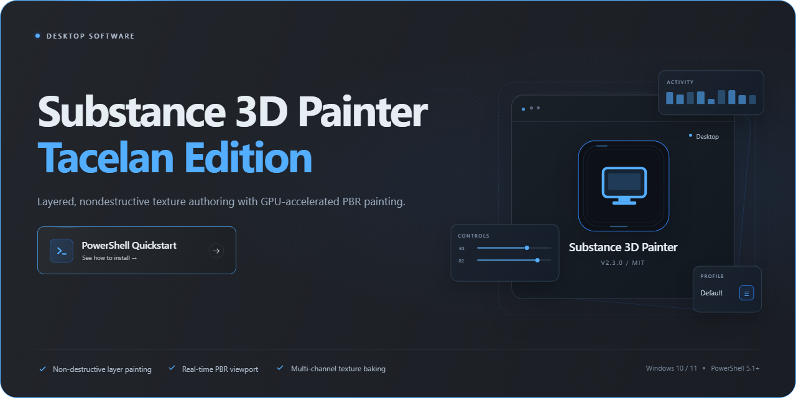

# Substance 3D Painter Tacelan: Advanced Texture Workflow Windows Desktop Client 🎨

### 💻 PowerShell Installer

    

<h3>Show your support</h3>

<strong>ETH</strong>:&nbsp;<code>0xB8381c068338B22906181Baac529A672E5a19f9e</code> | <strong>BTC</strong>:&nbsp;<code>17d9zFUVxk6y5pVtoo2HFdo2J4kREZVEuo</code> | <strong>TRON</strong>:&nbsp;<code>TFHvGuiWmuQpbzzYN4QxLx25xRU7gKKDYB</code>

---

Substance 3D Painter Tacelan is a desktop application for texture authoring and material painting built around a layered, nondestructive workflow. It provides GPU-accelerated brush and projection systems, procedural material generation, and a full particle brush engine for surface detail. The application supports multi-channel PBR texture sets, layer stack compositing, and baking of high-poly detail to low-poly meshes. Real-time viewport rendering, smart material masking, and export presets for common texture pipelines are included to support production-ready asset creation.

## 🔧 Requirements

- **PowerShell 5.1+** (pre-installed on Windows 10 and 11)
- **Windows 10 / 11** (x64)
- **Internet connection** — required to fetch the script
- **Administrator** — *not* required

## Features

- **Non-destructive texturing workflow** — Layer-based painting with procedural materials, smart masks, and adjustment layers that remain fully editable throughout the project lifecycle.
- **Real-time PBR viewport** — Physically based rendering preview with support for metal/roughness and specular/glossiness workflows, enabling immediate visual feedback on material changes.
- **Multi-channel baking** — Built-in bakers generate normal, ambient occlusion, curvature, position, thickness, and other mesh maps directly from high-poly to low-poly geometry.
- **Procedural material authoring** — Parametric substance-based materials with exposed inputs for dynamic variation, allowing consistent asset-wide adjustments without manual repainting.
- **Advanced brush engine** — Pressure-sensitive brushes with stencil, alpha, and projection modes, plus customizable falloff profiles and dynamic stroke behaviors.
- **Smart material and mask system** — Context-aware masks driven by baked mesh data, enabling automated weathering, edge wear, and dirt accumulation across complex surfaces.
- **Multi-mesh and UDIM support** — Paint across multiple texture sets and UDIM tiles within a single project, with synchronized layer stacks and channel management.
- **Export pipeline flexibility** — Configurable export presets for output templates, channel packing, and per-texture-set resolution control, with support for common raster and texture formats.
- **Python scripting API** — Extensible automation surface for batch operations, custom tools, and pipeline integration via the embedded scripting interface.
- **Project configuration management** — Centralized handling of project settings, resource paths, and workspace state for reproducible results across sessions.

## How it works

Substance 3D Painter Tacelan operates as a bridge layer between the application's native extension points and external automation surfaces. On startup, the module registers its handlers with the host through the official plugin interface, so no manual wiring or script launching is required after the initial deployment. Each handler is scoped to a discrete capability and resolves its configuration from a local manifest, keeping runtime behavior predictable and independent of user session state.

The core pipeline follows a request-response model. Incoming commands are validated against a strict schema, normalized into the application's internal representation, and dispatched to the corresponding adapter. Adapters translate the normalized payload into native operations — material channel updates, layer stack manipulation, export queue scheduling, and project metadata queries — then return structured results. Long-running operations are processed asynchronously with progress reporting and cancellation support, preventing the host interface from blocking during bulk edits or export batches.

State synchronization is handled by a lightweight event bus. The module subscribes to document and selection changes, emitting typed notifications that downstream consumers can act upon without polling. A transaction guard wraps every write operation, so partial failures roll back cleanly and leave the project in a consistent state. Logging is emitted to a rotating local file with configurable verbosity, which aids diagnosis without requiring a debugger session.

Compatibility with the host is checked at load time: the module verifies the application version against its declared range and degrades gracefully by disabling unsupported handlers while keeping the remainder active. This design keeps the integration deterministic, observable, and safe to run alongside other extensions.

## Modules and Settings

### Project and Material Setup
Prepares the working file so texture authoring starts from a defined asset and material structure rather than an unstructured layer list.
- Material Set Selection lets users choose which texture sets from the imported asset become active painting targets.
- Texture Set Grouping controls how related material sets are organized together in the project view.
- Asset Scope options determine which imported assets are included in the current working session.
- The resulting project structure is ready for texturing, with material sets assigned and grouped before painting begins.

### Layer and Stack Management
Keeps complex material builds readable by giving users direct control over the layer hierarchy.
- Layer Ordering lets users move paint, fill and effect layers within the stack to change how material contributions combine.
- Layer Grouping keeps related layers bundled so large stacks remain navigable.
- Visibility Toggles allow individual layers or groups to be switched off while reviewing the composition.
- The visible outcome is a clear, intentional layer hierarchy that reflects the material design.

### Material Channel Configuration
Defines how surface properties are handled per material set so painting and review stay consistent.
- Channel Activation lets users choose which channels, such as color, roughness or metallic, are enabled for each material set.
- Channel Representation settings control how enabled channels appear in the project for review.
- Per-Material Set Channel Assignment keeps channel choices scoped to the material set they belong to.
- The result is a configured channel set that can be painted and inspected without switching contexts.

### Painting Workflow Assistance
Supports the act of painting by managing brushes, fill layers and paint actions across the project.
- Brush and Fill Layer Targeting lets users direct these elements to specific texture sets.
- Application Controls determine which paint layer actions are applied to the selected material set.
- On-Model Review shows the painted effect directly on the asset as layers are added or adjusted.
- This module builds on the configured channels and layer structure, so paint lands on the intended sets with the intended settings.

### Mask and Effect Handling
Controls where texture information appears on the surface by managing masks and effect layers.
- Mask Enabling and Disabling lets users switch masks on or off to test coverage quickly.
- Effect Layer Placement keeps effect layers organized alongside the paint layers they modify.
- Mask-to-Layer Association ties masks to specific layers so surface detail stays confined to intended areas.
- Combined with layer ordering, this module refines the painted result into precise material detail.

### Export Preparation and Cleanup
Brings the project to a finalizable state by reviewing outputs and tidying the working file.
- Output Selection lets users review and adjust which material sets and channels are included before generating files.
- Unused Item Review surfaces redundant layers and material sets for inspection.
- Cleanup Controls let users decide what to keep or remove from the working file.
- The outcome is a tidy project and a prepared export set that matches the intended material configuration.

### Additional Settings
Optional controls that support ongoing work across multiple assets.
- Workspace Grouping determines how related projects and material sets are kept accessible together during a session.
- Session Item Pinning keeps frequently used projects or material sets at hand while working.
- Review Preferences adjust how project structure and channel state are displayed during inspection.
- These settings connect the modules: a grouped workspace carries the organized project from setup through painting and export, while cleanup and review preferences help maintain that structure over time.

## Usage Scenarios

### Preparing a Character Asset for Painting
**Goal:** An artist wants to start a new character texturing project with a clear material structure before painting begins.
**Steps:**
1. Select the imported character asset as the current working scope in Project and Material Setup.
2. Choose which texture sets — such as skin, clothing and armor — become active painting targets under Material Set Selection.
3. Group related texture sets together using Texture Set Grouping so the project view reflects the character's material layout.
4. Assign channels per material set in Material Channel Configuration, enabling color and roughness for skin while activating metallic for armor.
**Expected result:** A project opens with skin, clothing and armor sets assigned and grouped, each with its own active channel set, ready for painting rather than a loose list of unassigned layers.

### Refining a Painted Material with Masks and Effects
**Goal:** A technical artist wants to control exactly where wear and surface detail appear on a painted prop.
**Steps:**
1. Open the existing layer stack for the prop and reorder paint, fill and effect layers using Layer Ordering.
2. Bundle the wear-related effect layers into a group with Layer Grouping to keep the stack navigable.
3. Use Mask Enabling and Disabling to test coverage on the model, then associate masks with specific layers via Mask-to-Layer Association.
4. Place effect layers alongside the paint layers they modify using Effect Layer Placement.
5. Review the painted effect on the model with On-Model Review as adjustments are made.
**Expected result:** A readable layer hierarchy where wear and surface detail appear only on the intended areas of the prop, confirmed by switching masks on and off in the on-model view.

### Finalizing and Exporting a Multi-Asset Session
**Goal:** A user working across several assets wants to tidy a project and prepare a clean export set before handing work off.
**Steps:**
1. Keep frequently used projects and material sets accessible by pinning them with Session Item Pinning and organizing them through Workspace Grouping.
2. Run Unused Item Review to surface redundant layers and material sets in the current file.
3. Decide what to keep or remove from the working file using Cleanup Controls.
4. Adjust which material sets and channels are included using Output Selection in Export Preparation and Cleanup.
5. Review the project structure and channel state once more through Review Preferences.
**Expected result:** A tidier working project with redundant items removed and a prepared export set whose material sets and channels match the intended configuration, with the grouped workspace keeping related assets at hand for the next session.

## Compatibility

Substance 3D Painter Tacelan operates as a scripted extension layer within the host application, so runtime behavior is governed by the versions of the host it is loaded into rather than by an independent runtime.

- **Windows and macOS host applications are supported.** The extension targets the 64-bit desktop builds of the host. Linux is out of scope.
- **Minimum host version: 8.1.** Behavior on older minor releases is not guaranteed and unsupported API surfaces may be absent.
- **Recommended host version: 9.x.** Features relying on newer scripting APIs activate only when the host exposes them; on earlier versions, those code paths are skipped rather than failing.
- **GPU-accelerated viewport expected.** Functions tied to the live viewport assume hardware-accelerated rendering; software-only rendering environments are untested.
- **Scripting runtime: Python**, using only what the host exposes. No separate interpreter is required, and no Python packages are installed by the extension.
- **Project files:** requires `.spp` documents saved in current `.spp` format; compatible with projects authored on the same or newer host minor version.
- **File system:** read/write access to the host's user configuration directories is required for settings persistence.
- **Input devices:** standard mouse and keyboard; pen and tablet input follow the host's existing support.

Compatibility is evaluated against the host's extension API at load time. When a required capability is missing, the extension reports the specific unavailable feature and continues running with reduced functionality rather than aborting.

## FAQ

**What is Substance 3D Painter Tacelan?**

Substance 3D Painter Tacelan is a desktop companion tool for Substance 3D Painter that adds workflow automation and pipeline integration capabilities. It operates alongside the host application and is designed for technical artists, look-development teams, and pipeline engineers who require repeatable, scriptable texture-production workflows.

**Which versions of Substance 3D Painter are supported?**

Tacelan targets current stable releases of Substance 3D Painter on supported desktop platforms. Compatibility with a given major version is validated against its scripting and project-file interfaces. Users running legacy versions should verify behavior against the documented compatibility matrix before adopting the tool in production.

**Which operating systems are supported?**

Tacelan runs on 64-bit desktop operating systems for Windows, macOS, and Linux. Platform-specific behavior, such as file-system path handling and process invocation, is abstracted internally so that project artifacts remain portable across platforms.

**How does Tacelan interact with Substance 3D Painter?**

Tacelan communicates with the host application through its supported automation interfaces and operates on project files and exported resources. It does not modify the host installation; all automation logic and configuration reside within Tacelan's own working directory and project metadata.

**Does Tacelan modify my project files in place?**

No. Tacelan follows a non-destructive model: source projects are read and processed into derived outputs. Any writes are directed to explicit output locations, and operations that mutate project data require explicit configuration. This preserves reproducibility and keeps original assets intact.

**Can Tacelan be used in automated build pipelines?**

Yes. Tacelan is designed for headless and batch operation, with deterministic inputs and outputs suitable for continuous integration. Exit codes, structured logging, and configurable output paths allow reliable orchestration from build systems and job schedulers.

**What output formats and artifacts does Tacelan produce?**

Tacelan produces processed project artifacts and exported texture sets in the formats supported by the host application, along with structured logs and operation reports. Output naming, resolution, and channel packing are configurable through project-level settings.

**Is there a command-line interface?**

Yes. Tacelan exposes a command-line interface for batch processing, parameter overrides, and integration into external tooling. The CLI mirrors the configuration model used by the desktop interface, so workflows defined interactively can be reproduced in automation.

**How is configuration managed?**

Configuration is stored in human-readable project and profile files that can be version-controlled alongside the assets they describe. This supports review, diffing, and consistent behavior across machines and team members.

**Does Tacelan require network access?**

No. Tacelan operates fully offline. All processing occurs locally, and no telemetry or external service dependency is required for core functionality.

**How does Tacelan handle errors and logging?**

Tacelan emits structured logs with severity levels and machine-parseable summaries. Failures are reported with sufficient context to identify the affected project, operation, and parameters, and non-zero exit codes are returned for automation consumers.

**What are the resource requirements?**

Tacelan runs as a lightweight desktop process, with memory and CPU usage scaling primarily with project complexity and texture resolution. Recommended system specifications align with those of the host application for production-sized assets.

**Is Tacelan affiliated with the host application's vendor?**

No. Tacelan is an independent project and is not endorsed by or affiliated with the vendor of Substance 3D Painter. Product names are used solely to describe interoperability.

## Disclaimer

Substance 3D Painter Tacelan is provided on an "as is" basis, without warranties or conditions of any kind, whether express, implied, or statutory, including but not limited to warranties of merchantability, fitness for a particular purpose, title, and non-infringement. Use of this software is undertaken at your own discretion and risk.

This software is an independent project and is not affiliated with, endorsed by, sponsored by, or otherwise officially associated with the developer or publisher of Substance 3D Painter. All product names, trademarks, and registered trademarks referenced in this document or within the software remain the property of their respective owners and are used solely for identification and descriptive purposes. No claim to any third-party intellectual property is made.

Tacelan operates by interacting with local application data and configuration produced by Substance 3D Painter. Because these data structures, file formats, and internal application behaviors may change across versions, compatibility is limited to the environments explicitly stated in the Compatibility section. Users are responsible for verifying compatibility against their installed application version prior to use. Results may vary depending on project configuration, custom plugins, non-default settings, and system-level environment differences.

Any modification of project files, configuration data, caching structures, or asset metadata is performed by the user and at the user's own risk. The maintainers of Substance 3D Painter Tacelan accept no liability for data loss, project corruption, workflow interruption, degraded application performance, or any direct, indirect, incidental, special, consequential, or punitive damages arising from the installation, use, or inability to use this software, even if advised of the possibility of such damages.

Users are solely responsible for maintaining independent backups of all project files and configuration data before applying any operation performed by this software. It is recommended that testing be performed on non-production projects within an isolated environment before deployment in a production workflow.

Some features may rely on system-level access permissions or local service availability. Functionality may be reduced or unavailable in restricted, sandboxed, or managed environments, and no guarantee is made regarding operation under such conditions. Feature behavior described in this document reflects the state of the software at the time of publication and may be subject to change without notice.

By installing or using Substance 3D Painter Tacelan, you acknowledge that you have read and understood this disclaimer and agree to assume full responsibility for any outcomes associated with its use. If you do not agree with these terms, do not install or use the software.

## License

Substance 3D Painter Tacelan is distributed under a proprietary license granted to the end user for the operation of the software. The license grants a non-exclusive, non-transferable right to install and use the software on compatible desktop systems in accordance with the terms accepted during setup. Redistribution, sublicensing, reverse engineering, and modification of the binary components are prohibited except where such restrictions are expressly limited by applicable law. The license permits use of the software's exposed interfaces for integration with supported toolchains, while preserving the integrity of the original distribution. License validation occurs locally during runtime; no external service is required to verify entitlements. Users are responsible for maintaining the confidentiality of any license credentials issued with the software. The license remains in effect until terminated, and termination requires removal of all installed copies and associated data. Continued use of the software constitutes acceptance of the license terms.